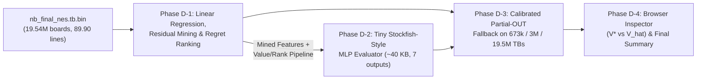

# Plan: Distilling the Tablebase into Better Heuristics & Partial-TB Fallbacks

Goal: Use our solved `19.54M`-board Next-Box tablebase (`nb_final_nes.tb.bin` — **`136.8 million`** exact `(board, piece) → V*(b, c)` ground-truth values) to improve both **standalone heuristic play** and **out-of-tablebase fallback play**, directly prototyping techniques we will need for real 20-row StackRabbit (`src/backend/eval.cpp` and future DAS 18/19 tablebases).

Companion docs:
- [tablebase_nextbox_plan.md](tablebase_nextbox_plan.md) — completed Next-Box tablebase (`89.90` NES lines, `670.9 MB`).
- [tablebase_retrospective.md](tablebase_retrospective.md) — scaling & architecture lessons for DAS 18/19.

---

## 1. Why This Matters for Real StackRabbit

Even on our tiny 4×10 board, **`27.14%` of games** leave the `19.54M`-board tablebase at least once (`72.86%` stay 100% inside). On those escaped games, our simple hand-tuned 2-ply fallback rescues **`+11.2` extra lines per game** (lifting overall mean from `86.85` closed-world to `89.90` live).

On a full 20-row DAS 18/19 board, no tablebase will ever cover `99.8%` of messy digs and high stacks — a practical tablebase will cover the clean stacking core (`~80–95%` of moves) and frequently cross the boundary into out-of-TB territory. This exploration answers four concrete questions before we build a DAS 18/19 tablebase:

1. **Can exact TB supervision dramatically beat Monte Carlo weight tuning on the *exact same* 11 linear features?**
   How far above our current `30.05 ± 0.28` Next-Box 2-ply heuristic baseline can we push just by fitting the existing `EvalWeights` on `nb_final_nes.tb.bin` using regret-weighted move ranking instead of noisy game rollouts?
2. **Can residual error mining discover missing hand-crafted features?**
   By inspecting the boards with the largest error `|V_hat(b) - V*(b)|`, what structural concepts is our hand-crafted eval missing — and which of those translate directly to StackRabbit's production `eval.cpp`?
3. **How strong is a tiny Stockfish-style neural evaluator (`~30–60 KB`) distilled from a `670 MB` tablebase?**
   Can a cache-resident C++ MLP predicting all 7 `V_hat(b, c)` values in `< 2 µs` bridge most of the gap between `30.05` (hand-crafted heuristic) and `89.90` (`670 MB` tablebase) — while generalizing smoothly to unseen `3+`-hole boards?
4. **How should a partial-coverage tablebase score out-of-TB moves (`partial-OUT` vs `all-OUT`)?**
   Today, if *any* legal move lands in-TB, every out-of-TB move is valued at `0.0` (forcing the agent to pick a terrible in-TB move over a great out-of-TB move). On a realistic partial-coverage tablebase (~80–95% hit rate), how much does scoring out-of-TB children with a conservative calibrated estimate `max(0, V_hat(b', n) - margin)` improve live survival without creating optimistic "exit traps"?

---

## 2. Dataset, Weighting & Evaluation Discipline

### Why Uniform Sampling Over `.tb.bin` Would Fail
From [tablebase_retrospective.md](tablebase_retrospective.md#L156-L168), `85.7%` of boards stored in `nb_final.states.bin` have sealed holes, while **`86.0%` of live moves** occur on `0`-hole boards. Training uniformly over every row of `.tb.bin` would spend `85%` of model capacity on rare scramble states and underfit the clean core that decides most games.

### On-Policy Trajectory Sampling with Controlled Recovery Mixing
Instead of iterating rows of `.tb.bin` uniformly, we sample `(b, c, n)` positions directly from fast self-play rollouts of `nb_final_nes.tb.bin` (`~2.4M mv/s` on 10 cores — `1M` labeled positions take `< 0.5s`!):
- **70% on-policy greedy `nb_final_nes` moves**: weights boards automatically by true strong-play visitation frequency.
- **30% `ε`-perturbed / recovery moves** (`ε = 0.08` 50/50 TB runner-up + heuristic probe): ensures the model sees plenty of `1–3+`-hole recoveries and near-frontier positions where out-of-TB fallback actually triggers.
- Every sampled `(b, c, n)` position immediately gives both:
  - Exact target values **`V*(b, c)`** (for all `c = 0..6`), and
  - Exact move-level Q-values **`Q*(b, c, n, m) = r_m + V*(b'_m, n)`** across all legal moves `m` (skipping moves with `b'_m ∉ S`, or filtering to fully-in-TB decision points so move rankings have zero boundary bias).

### Strict Split & Zero-Dependency C++17 Toolchain
- **Train rollouts**: seeds `20,000,000+`
- **Validation rollouts** (value MAE/R², top-1 move agreement, mean regret in lines/move): seeds `30,000,000+`
- **Held-out gameplay benchmark**: exact same **10,000 NES games (`seed=700000`)** used across Phases NB-1–NB-4, keeping `src/` completely untouched and writing everything in zero-dependency multi-threaded C++17 under `experimental/tablebase/` (no Python/PyTorch dependencies needed; native 10-core Apple M5 speed and 100% bit-exact feature parity between training and inference).

---

## 3. Phased Implementation Plan

### Phase D-1: Linear Distillation, Residual Mining & Feature Discovery (`distill_linear.hpp`, `distill_linear.cpp`)
Establish the exact ceiling of fast, interpretable linear heuristics — directly applicable to StackRabbit's hand-crafted `src/backend/eval.cpp`.

- [x] **Trajectory dataset sampler** (`distill_data.hpp`):
  - Deterministic, chunked 70% greedy + 30% `ε=0.08` recovery rollouts over `nb_final_nes.tb.bin`, filtering out-of-TB candidate moves per-decision (keeping decisions with `>= 2` in-TB moves) so ~99% of decisions are retained with zero `V=0` boundary bias.
- [x] **Step 1a — Linear Value Regression (V1 10 features + intercept)**:
  - Val $R^2 = 0.6812$, RMSE `6.086`, MAE `3.714` lines (`0h=2.82`, `1h=8.45`, `2h=15.34`, `3+h=21.86`).
  - Residual outlier mining exposed two structural blind spots in V1:
    1. **Overestimated traps** (`V_hat >> V*`, up to `+41` lines): isolated row-0 pinholes buried under `>= 2` messy covering rows.
    2. **Underestimated strong setups** (`V_hat << V*`, up to `-71` lines): contiguous multi-hole cavities sitting under a single nearly-full covering row (`1–2` cells from clearing and wiping all holes in one shot).
- [x] **Step 1b — Regret-Weighted Move Ranking (same 10 V1 features)**:
  - Ranking board-only `V(b)` against piece-averaged `expectedQStar = r + E_NES[V*(b')]` lifts the exact same 10-feature model from `30.05 ± 0.28` (hand-tuned) and `27.89 ± 0.26` (V1 Ridge MSE) to **`31.73 ± 0.30`** (`+1.68` lines; validation regret `0.7549 → 0.6924`).
- [x] **Step 1c — Residual-Guided V2 Linear Feature Set (`26` interpretable features)**:
  - Adding 16 residual-guided features (`hasAnyHole`, `holeColumns`, `holeRows`, `coveredMinoCount`, `buriedDepth2Plus`, `coverRowMissing`, `minHoleRowPenalty`, `totalCells`, `maxHeight`, `rowTransitions`, `colTransitions`, `edgeHeightSum`, `centerHeightSum`, `wellCount`, `maxWellDepth`, `adjHighColPairs`) jumps Val $R^2$ from `0.6812 → 0.8139`, cuts `3+h` value MAE from `21.86 → 8.40`, and lifts 10,000-game held-out NES survival (`seed=700000`) to:
    - V2 Ridge 2-ply: **`42.85 ± 0.41`** (`+12.80` lines)
    - V2 Joint-Rank 2-ply: **`46.86 ± 0.46`** (`+16.81` lines)
    - V2 Pure-Rank 2-ply (`--mode=nextbox-heur-v2`): **`48.94 ± 0.46`** (**`+18.89` lines / `+62.9%`**, `med=35.0`, `p90=111`, `max=436`, top-1 `83.56%`, meanRegret `0.4084`, `300.5k mv/s`).
  - Top-weight takeaways actionable for real Tetris: `holeRows` (penalize distinct rows containing holes, not just raw hole count), `rowTransitions`, `coveredMinoCount`, and `buriedDepth2Plus` carry far more signal than raw `sealedHoles` alone.
- [x] **Verification**:
  - `tablebase_test.cpp` (21/21): exact Ridge recovery, singular/NaN/constant-target guards, V1/V2 prefix parity & explicit board checks, central finite-difference gradient check (`< 1e-6`), `1T` vs `4T` sampling determinism, `benchmark_cli --mode=nextbox-heur-v2`, plus Logic & Simplicity code reviews passed.

---

### Phase D-2: Compact Stockfish-Style Neural Evaluator (`tiny_nn.hpp`, `train_nn.cpp`)
Test how much of a `670 MB` tablebase can be compressed into a **`~30–60 KB`** cache-resident C++ neural network predicting all 7 `V_hat(b, c)` values directly.

- [ ] **Compact Architecture (`TinyNextBoxNet`)**:
  - **Input layer (~60–80 floats)**: 40 raw binary cells (`b` bits `0..39`) + normalized structural inputs (10 column heights, 10 column hole indicators, overhang/sealed counts, row fills, parity).
  - **Hidden layers**: `FC(in → H1) + ClippedReLU` → `FC(H1 → H2) + ClippedReLU` → `FC(H2 → 7)` outputting **`V_hat(b, c)` for all 7 pieces `c = 0..6`** simultaneously (matching the exact shape of `SRTBV002`!).
  - Start with `H1 = 64, H2 = 32` (`~6.5k` params = **`26 KB`** float32) and optionally compare against `H1 = 128, H2 = 64` (`~18k` params = **`72 KB`**).
  - Clean binary weight format (`SRNNV001` with magic, architecture dims, input feature version, and float32 weights) loadable in `< 1 ms`.
- [ ] **Multi-Task Training (`train_nn.cpp`)**:
  - Joint loss:
    $$\mathcal{L} = \mathcal{L}_{\text{Huber/MSE}}\big(\hat{V}(b, 0..6),\; V^*(b, 0..6)\big) + \lambda \cdot \mathcal{L}_{\text{regret-rank}}\big(r_m + \hat{V}(b'_m, n),\; Q^*(b, c, n, m)\big)$$
  - Multi-threaded data-parallel mini-batch Adam with cosine learning-rate schedule and validation checkpointing (saving the model with lowest validation move regret).
- [ ] **Fast Inference & Benchmarks (`benchmark_cli.cpp`)**:
  - Add `--mode=nextbox-nn --nn=PATH` supporting both:
    - **1-ply NN**: `argmax_m [r_m + V_hat(b'_m, n)]` (single NN forward pass per candidate child — ultra-fast, directly mirrors 1-ply TB lookup!), and
    - **2-ply NN**: `argmax_{m1} [r_1 + max_{m2} (r_2 + E_NES[V_hat(b''_{m2}, p_3)])]` (tests whether 2-ply search over a distilled `V_hat(b, c)` closes even more of the gap to `89.90`!).
  - Measure exact 10k-game NES score (`seed=700000`), validation regret, throughput (`mv/s`), and generalization on **out-of-TB boards** (comparing `V_hat` accuracy on held-out `nb_final \ round8` boards when trained only on `round8`!).
- [ ] **Verification**:
  - Finite-difference numerical gradient check across every layer in `tablebase_test.cpp` (relative error `< 1e-4`), `SRNNV001` save/load + corruption rejection tests, and deterministic `1T` vs `4T` inference parity.

---

### Phase D-3: Calibrated Partial-OUT Fallback & Partial-TB Hybrid Bridge (`nextbox_solver.hpp`, `benchmark_cli.cpp`)
Directly test the **incomplete-tablebase regime** that real 20-row DAS 18/19 Tetris will operate in.

- [ ] **Build 3 Controlled Partial-Coverage Test Regimes** (all evaluated on the exact same 10,000 NES games, `seed=700000`):
  1. **Small TB (`nb_small_nes.tb.bin`, `round0` `673k` boards, solved for NES)**: `~80–85%` in-TB coverage (`E[V(0)] = 19.56`, baseline live `34.55`) — directly mimics a compact DAS 18/19 core tablebase!
  2. **Medium TB (`nb_mid_nes.tb.bin`, e.g. `round2` `2.49M` NNB boards solved for NES, or `0h+1h` core subset)**: `~92–95%` in-TB coverage.
  3. **Full TB (`nb_final_nes.tb.bin`, `19.54M` boards)**: `99.79%` in-TB coverage (`89.90` baseline).
  *(Note: to avoid data leakage when testing `nb_small_nes` / `nb_mid_nes`, also test a neural evaluator distilled **only** from `nb_small_nes` / `nb_mid_nes` — proving whether self-distillation from a partial TB already improves that same partial TB!)*
- [ ] **Implement Calibrated Partial-OUT Move Selection (`chooseNextBoxHybridFallbackMove`)**:
  - For each legal move `m` on `(b, c, n)`:
    - If `b'_m ∈ TB`: `Q(m) = r_m + V_tb(b'_m, n)`.
    - If `b'_m ∉ TB`: `Q(m) = r_m + max(0.0, V_hat(b'_m, n) - safetyMargin)`.
  - Sweep `safetyMargin ∈ {0.0, 1.0, 2.0, 5.0, 10.0, +inf (all-OUT only)}` on validation seeds (`30,000,000+`) to find the optimal conservatism margin that prevents optimistic "exit traps", then evaluate once on the held-out `10,000` NES games (`seed=700000`).
- [ ] **Head-to-Head Partial-TB Table**:
  - For each coverage regime (`673k`, `2.5M`, `19.54M`), compare:
    1. Closed-world TB (`V = 0` outside),
    2. Live TB + original hand-tuned 2-ply all-OUT fallback,
    3. Live TB + distilled NN all-OUT fallback,
    4. Live TB + calibrated distilled NN **partial-OUT** scoring (`optimal margin`).
  - Also test **1-round bootstrap**: does generating `nb_round1` using the distilled NN as the frontier probe beat generating with the hand-tuned 2-ply heuristic?
- [ ] **Verification**:
  - Unit tests in `tablebase_test.cpp` verifying `safetyMargin = +inf` reproduces exact existing `chooseNextBoxTablebaseMove`, verifying `safetyMargin` clamping at `>= 0.0`, and verifying zero crashes / NaN safety on top-out and unloaded-NN edge cases.

---

### Phase D-4: Interactive Visual Inspector & Retrospective Update (`server_routes.hpp`, `index.html`, `docs/tablebase_retrospective.md`)
Make the distilled evaluator inspectable side-by-side with the tablebase in the browser and persist all learnings for StackRabbit.

- [ ] Extend `tablebase_server` with an optional `--nn=PATH` flag (preserving existing `[port] [tb.bin]` CLI compatibility) and expose `nnValue` / `nnQ` in `/moves` and `/state-info` when loaded.
- [ ] Update `index.html` to optionally play the `TinyNextBoxNet` policy live, compare `V*(b, c)` vs. `V_hat(b, c)` error in the stats card, and step directly to **TB vs. NN disagreements**.
- [ ] Record the complete distillation benchmark table, discovered Tetris eval features (actionable for `src/backend/eval.cpp`), and calibrated partial-OUT findings in [docs/tablebase_retrospective.md](tablebase_retrospective.md).

---

## 4. Quality Gates & Review Protocol

Follow the upgraded workflow from [tablebase_retrospective.md](tablebase_retrospective.md#L237-L251):
- Keep all code isolated under `experimental/tablebase/` (`src/` untouched) with zero external build dependencies.
- After every phase:
  1. `npm run format_cpp`
  2. Compile all binaries with `-Wall -Wextra -Werror` and `-DNDEBUG -fsyntax-only`
  3. Run `./build/tablebase_test`, `npm run cpp_test_unit`, and `npm run precompute_static_lint`
  4. Run **Logic Reviewer** (with the 4-point seam checklist: cross-component parity, scale/RAM audit, adversarial test audit, `-DNDEBUG`/hostile-input audit) + **Simplicity Reviewer** — and add the **3rd Performance & Scale Reviewer** on Phase D-2's neural training/inference hot path!
  5. Commit cleanly per phase (`Phase D-1 (...)`, `Phase D-2 (...)`, etc.).
