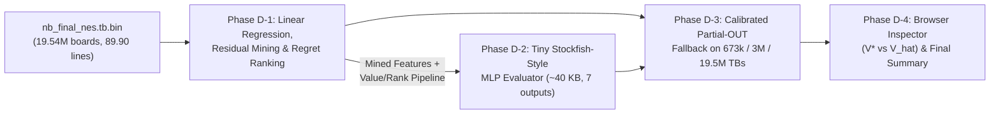

# Plan: Distilling the Tablebase into Better Heuristics & Partial-TB Fallbacks

Goal: Use our solved `19.54M`-board Next-Box tablebase (`nb_final_nes.tb.bin` — **`136.8 million`** exact `(board, piece) → V*(b, c)` ground-truth values) to improve both **standalone heuristic play** and **out-of-tablebase fallback play**, directly prototyping techniques we will need for real 20-row StackRabbit (`src/backend/eval.cpp` and future DAS 18/19 tablebases).

Companion docs:
- [tablebase_nextbox_plan.md](tablebase_nextbox_plan.md) — completed Next-Box tablebase (`89.90` NES lines, `670.9 MB`).
- [tablebase_retrospective.md](tablebase_retrospective.md) — scaling & architecture lessons for DAS 18/19.

---

## 1. Why This Matters for Real StackRabbit

Even on our tiny 4×10 board, **`27.14%` of games** leave the `19.54M`-board tablebase at least once (`72.86%` stay 100% inside). On those escaped games, our simple hand-tuned 2-ply fallback rescues **`+11.2` extra lines per game** (lifting overall mean from `86.85` closed-world to `89.90` live).

On a full 20-row DAS 18/19 board, no tablebase will ever cover `99.8%` of messy digs and high stacks — a practical tablebase will cover the clean stacking core (`~80–95%` of moves) and frequently cross the boundary into out-of-TB territory. This exploration answers four concrete questions before we build a DAS 18/19 tablebase:

1. **Can exact TB supervision dramatically beat Monte Carlo weight tuning on the *exact same* 11 linear features?**
   How far above our current `30.05 ± 0.28` Next-Box 2-ply heuristic baseline can we push just by fitting the existing `EvalWeights` on `nb_final_nes.tb.bin` using regret-weighted move ranking instead of noisy game rollouts?
2. **Can residual error mining discover missing hand-crafted features?**
   By inspecting the boards with the largest error `|V_hat(b) - V*(b)|`, what structural concepts is our hand-crafted eval missing — and which of those translate directly to StackRabbit's production `eval.cpp`?
3. **How strong is a tiny Stockfish-style neural evaluator (`~30–60 KB`) distilled from a `670 MB` tablebase?**
   Can a cache-resident C++ MLP predicting all 7 `V_hat(b, c)` values in `< 2 µs` bridge most of the gap between `30.05` (hand-crafted heuristic) and `89.90` (`670 MB` tablebase) — while generalizing smoothly to unseen `3+`-hole boards?
4. **How should a partial-coverage tablebase score out-of-TB moves (`partial-OUT` vs `all-OUT`)?**
   Today, if *any* legal move lands in-TB, every out-of-TB move is valued at `0.0` (forcing the agent to pick a terrible in-TB move over a great out-of-TB move). On a realistic partial-coverage tablebase (~80–95% hit rate), how much does scoring out-of-TB children with a conservative calibrated estimate `max(0, V_hat(b', n) - margin)` improve live survival without creating optimistic "exit traps"?

---

## 2. Dataset, Weighting & Evaluation Discipline

### Why Uniform Sampling Over `.tb.bin` Would Fail
From [tablebase_retrospective.md](tablebase_retrospective.md#L156-L168), `85.7%` of boards stored in `nb_final.states.bin` have sealed holes, while **`86.0%` of live moves** occur on `0`-hole boards. Training uniformly over every row of `.tb.bin` would spend `85%` of model capacity on rare scramble states and underfit the clean core that decides most games.

### On-Policy Trajectory Sampling with Controlled Recovery Mixing
Instead of iterating rows of `.tb.bin` uniformly, we sample `(b, c, n)` positions directly from fast self-play rollouts of `nb_final_nes.tb.bin` (`~2.4M mv/s` on 10 cores — `1M` labeled positions take `< 0.5s`!):
- **70% on-policy greedy `nb_final_nes` moves**: weights boards automatically by true strong-play visitation frequency.
- **30% `ε`-perturbed / recovery moves** (`ε = 0.08` 50/50 TB runner-up + heuristic probe): ensures the model sees plenty of `1–3+`-hole recoveries and near-frontier positions where out-of-TB fallback actually triggers.
- Every sampled `(b, c, n)` position immediately gives both:
  - Exact target values **`V*(b, c)`** (for all `c = 0..6`), and
  - Exact move-level Q-values **`Q*(b, c, n, m) = r_m + V*(b'_m, n)`** across all legal moves `m` (skipping moves with `b'_m ∉ S`, or filtering to fully-in-TB decision points so move rankings have zero boundary bias).

### Strict Split & Zero-Dependency C++17 Toolchain
- **Train rollouts**: seeds `20,000,000+`
- **Validation rollouts** (value MAE/R², top-1 move agreement, mean regret in lines/move): seeds `30,000,000+`
- **Held-out gameplay benchmark**: exact same **10,000 NES games (`seed=700000`)** used across Phases NB-1–NB-4, keeping `src/` completely untouched and writing everything in zero-dependency multi-threaded C++17 under `experimental/tablebase/` (no Python/PyTorch dependencies needed; native 10-core Apple M5 speed and 100% bit-exact feature parity between training and inference).

---

## 3. Phased Implementation Plan

### Phase D-1: Linear Distillation, Residual Mining & Feature Discovery (`distill_linear.hpp`, `distill_linear.cpp`)
Establish the exact ceiling of fast, interpretable linear heuristics — directly applicable to StackRabbit's hand-crafted `src/backend/eval.cpp`.

- [x] **Trajectory dataset sampler** (`distill_data.hpp`):
  - Deterministic, chunked 70% greedy + 30% `ε=0.08` recovery rollouts over `nb_final_nes.tb.bin`, filtering out-of-TB candidate moves per-decision (keeping decisions with `>= 2` in-TB moves) so ~99% of decisions are retained with zero `V=0` boundary bias.
- [x] **Step 1a — Linear Value Regression (V1 10 features + intercept)**:
  - Val $R^2 = 0.6812$, RMSE `6.086`, MAE `3.714` lines (`0h=2.82`, `1h=8.45`, `2h=15.34`, `3+h=21.86`).
  - Residual outlier mining exposed two structural blind spots in V1:
    1. **Overestimated traps** (`V_hat >> V*`, up to `+41` lines): isolated row-0 pinholes buried under `>= 2` messy covering rows.
    2. **Underestimated strong setups** (`V_hat << V*`, up to `-71` lines): contiguous multi-hole cavities sitting under a single nearly-full covering row (`1–2` cells from clearing and wiping all holes in one shot).
- [x] **Step 1b — Regret-Weighted Move Ranking (same 10 V1 features)**:
  - Ranking board-only `V(b)` against piece-averaged `expectedQStar = r + E_NES[V*(b')]` lifts the exact same 10-feature model from `30.05 ± 0.28` (hand-tuned) and `27.89 ± 0.26` (V1 Ridge MSE) to **`31.73 ± 0.30`** (`+1.68` lines; validation regret `0.7549 → 0.6924`).
- [x] **Step 1c — Residual-Guided V2 Linear Feature Set (`26` interpretable features)**:
  - Adding 16 residual-guided features (`hasAnyHole`, `holeColumns`, `holeRows`, `coveredMinoCount`, `buriedDepth2Plus`, `coverRowMissing`, `minHoleRowPenalty`, `totalCells`, `maxHeight`, `rowTransitions`, `colTransitions`, `edgeHeightSum`, `centerHeightSum`, `wellCount`, `maxWellDepth`, `adjHighColPairs`) jumps Val $R^2$ from `0.6812 → 0.8139`, cuts `3+h` value MAE from `21.86 → 8.40`, and lifts 10,000-game held-out NES survival (`seed=700000`) to:
    - V2 Ridge 2-ply: **`42.85 ± 0.41`** (`+12.80` lines)
    - V2 Joint-Rank 2-ply: **`46.86 ± 0.46`** (`+16.81` lines)
    - V2 Pure-Rank 2-ply (`--mode=nextbox-heur-v2`): **`48.94 ± 0.46`** (**`+18.89` lines / `+62.9%`**, `med=35.0`, `p90=111`, `max=436`, top-1 `83.56%`, meanRegret `0.4084`, `300.5k mv/s`).
  - Top-weight takeaways actionable for real Tetris: `holeRows` (penalize distinct rows containing holes, not just raw hole count), `rowTransitions`, `coveredMinoCount`, and `buriedDepth2Plus` carry far more signal than raw `sealedHoles` alone.
- [x] **Verification**:
  - `tablebase_test.cpp` (21/21): exact Ridge recovery, singular/NaN/constant-target guards, V1/V2 prefix parity & explicit board checks, central finite-difference gradient check (`< 1e-6`), `1T` vs `4T` sampling determinism, `benchmark_cli --mode=nextbox-heur-v2`, plus Logic & Simplicity code reviews passed.

---

### Phase D-2: Compact Stockfish-Style Neural Evaluator (`tiny_nn.hpp`, `train_nn.cpp`)
Test how much of a `670 MB` tablebase can be compressed into a **`~30–80 KB`** cache-resident C++ neural network predicting all 7 `V_hat(b, c)` values directly.

- [x] **Compact Architecture (`TinyNextBoxNet`, `SRNNV001`)**:
  - **Input layer (`88` floats)**: 40 raw binary cells + 10 col heights + 10 col hole counts + 4 row fills + 24 normalized V2 structural summaries, using bitwise `rowTransitions`/`colTransitions` and a 16-entry `constexpr` column LUT.
  - **Hidden layers**: `FC(88 → H1) + ReLU` → `FC(H1 → H2) + ReLU` → `FC(H2 → 7)` with sparsity-exploiting `[in x H1]` / `[H1 x H2]` / `[7 x H2]` layout, branchless NEON ReLU, 4-lane dot products, `< 4 KB` fast-path stack buffers, and strict `SRNNV001` binary I/O.
  - Compared **`64x32`** (`8,007` params = **`31.3 KB`**) and **`128x64`** (`20,103` params = **`78.6 KB`**).
- [x] **Multi-Task Training (`train_nn.cpp`)**:
  - Joint loss combining parent 7-output Huber (`valueWeight=1.0`), **candidate-child Huber (`childValueWeight=1.0`)**, exact terminal ply-2 top-out supervision (`includeTerminalOutMoves=true`), and Boltzmann move-ranking CE (`rankWeight=4.0, T=1.0`) with a persistent thread pool, `alignas(128)` worker states, parallel validation, and cosine Adam decay.
  - Adding candidate-child + terminal top-out supervision was decisive: lifted `64x32` 2-ply from `52.67 → 65.88` lines and 1-ply from `15.05 → 22.73` lines.
- [x] **Fast Inference & Benchmarks (`10,000` held-out NES games, `seed=700000`)**:
  - `64x32` (`31.3 KB`): `valMAE=2.893`, 1-ply `top1=78.68%` (`regret=0.7908`) → **1-ply `22.73 ± 0.22`** (`383.2k mv/s`), **2-ply `65.88 ± 0.64`** (`med=47.0`, `p90=146`, `max=577`).
  - `128x64` (`78.6 KB`, **8,535× smaller** than `670.9 MB` TB): `valMAE=2.463` (`0h=1.78`), 1-ply `top1=81.47%` (`regret=0.5786`) → **1-ply `32.27 ± 0.31`** (beats 2-ply hand-tuned `30.05`!), **2-ply `71.79 ± 0.68`** (`med=52.0`, `p90=161`, `max=958` — closing **70%** of the gap to the `89.90` tablebase!).
  - Out-of-TB generalization (`nb_round0_nes` → `nb_final_nes \ round8`): `OOD MAE = 12.60` (`0h=9.42`), of which `~7.5` lines is the global closed-world offset between `round8` (`79.4`) and `nb_final` (`86.85`) — confirming strong relative generalization on unseen states.
- [x] **Verification**:
  - `tablebase_test.cpp` (22/22): 6-block central finite-difference gradient check (`W1, b1, W2, b2, W3, b3`), full `SRNNV001` corruption & transactional load guards, bitwise feature parity & `hasAnyLegalTransition` parity, `1T` vs `4T` inference parity, Markov `evalNextPieceExpected` per-piece clamp test, plus Logic, Simplicity, and Performance & Scale reviews passed.

---

### Phase D-3: Calibrated Partial-OUT Fallback & Partial-TB Hybrid Bridge (`tiny_nn.hpp`, `nextbox_gen.hpp`, `generate_nextbox.cpp`, `benchmark_cli.cpp`)
Directly test the **incomplete-tablebase regime** that real 20-row DAS 18/19 Tetris will operate in.

- [x] **Built 3 Controlled Partial-Coverage Test Regimes** (all evaluated on the exact same 10,000 held-out NES games, `seed=700000`, with **zero-leakage self-distilled NNs** trained *only* on each partial TB):
  1. **Small TB (`nb_small_nes.tb.bin`, `round0` `673,453` boards = 3.4% of full TB, solved in `18.8s`)**: `E[V(0)] = 19.56`, baseline live `33.92 ± 0.32` (`93.94%` in-TB, `5.61%` 100%-covered games). Self-distilled `nb_small_self_64x32.nn.bin` (`31.3 KB`, trained in `18.6s`) plays standalone at **`45.95 ± 0.44`** (+12.03 lines *above* its own teacher TB!).
  2. **Medium TB (`nb_mid_nes.tb.bin`, `round2` `2,487,192` boards = 12.7% of full TB, solved in `120.3s`)**: `E[V(0)] = 43.07`, baseline live `50.97 ± 0.48` (`98.51%` in-TB, `27.97%` 100%-covered games). Self-distilled `nb_mid_self_64x32.nn.bin` (`31.3 KB`, trained in `29.6s`) plays standalone at **`56.09 ± 0.54`** (+5.12 lines *above* its own teacher TB!).
  3. **Full TB (`nb_final_nes.tb.bin`, `19,540,639` boards)**: `E[V(0)] = 86.85`, baseline live `89.90 ± 0.88` (`99.79%` in-TB, `72.86%` 100%-covered games).
- [x] **Implemented Calibrated Partial-OUT Move Selection (`chooseNextBoxHybridFallbackMove`)**:
  - Pass 1 looks up all legal children in the TB; if `all-OUT`, ranks directly with the NN once (zero margin clamping, zero duplicate work). If `anyInTb`, scores out-of-TB moves with `r_m + max(0.0, estCont(b'_m, n) - safetyMargin)` (preferring in-TB on ties), reproducing `chooseNextBoxTablebaseMove` bit-for-bit when `safetyMargin = +inf`.
  - Validation margin sweep (`seed=30000000`, `2,000` NES games) across `margin ∈ {0, 1, 2, 5, 10, inf}` identified the sweet spot at **`margin = 1.0–2.0` lines** across all 3 regimes.
- [x] **Head-to-Head Partial-TB Table (`10,000` held-out NES games, `seed=700000`)**:
  - **Small (`673k`)**: Closed-world `19.56` | Live TB+Heur `33.92 ± 0.32` | Live TB+NN all-OUT `33.35 ± 0.32` | Standalone Self-NN `45.95 ± 0.44` | **Live TB+Self-NN Partial-OUT (`m=2.0`) `45.14 ± 0.43`** (**`+11.22` lines / `+33.1%`**).
  - **Mid (`2.49M`)**: Closed-world `43.07` | Live TB+Heur `50.97 ± 0.48` | Live TB+NN all-OUT `51.01 ± 0.49` | Standalone Self-NN `56.09 ± 0.54` | **Live TB+Self-NN Partial-OUT (`m=1.0`) `67.59 ± 0.65`** (**`+16.62` lines / `+32.6%`**, beating *both* the TB and standalone NN by `+11.50` lines!).
  - **Full (`19.54M`)**: Closed-world `86.85` | Live TB+Heur `89.90 ± 0.88` | Live TB+NN all-OUT `90.02 ± 0.88` | 1-ply Partial-OUT (`m=2.0`) `92.00 ± 0.91` | **2-ply Partial-OUT (`m=2.0`) `104.02 ± 1.02`** (`med=74.0`, `p90=235`, `in-TB=99.06%`, **`+14.12` lines / `+15.7%`**, breaking 100 expected lines by escaping `V=0` boundary cliffs on just `0.73%` of moves!).
  - **1-Round Frontier Bootstrap A/B** (`nb_small_nes` `673k`, 50k games, `eps=0.08`, warm-start solved): Heuristic probe (`+49.3k` boards) gave `E[V(0)] = 19.56 → 20.49` (`+0.93`) and live `33.92 → 34.78` (`+0.86`); self-distilled NN probe (`+60.6k` boards) gave `E[V(0)] = 19.56 → 21.90` (**`+2.34` = 2.51× faster Bellman progress**) and live `33.92 → 36.76` (**`+2.84` = 3.30× faster live progress**).
- [x] **Verification**:
  - `tablebase_test.cpp` (23/23): `+inf`/`NaN`/`-inf`/`nullptr` parity with `chooseNextBoxTablebaseMove` (including out-of-TB higher-line-clear moves), `1-ply` & `2-ply` partial-OUT margin clamping, non-constant NN all-OUT ordering, out-of-range piece guards, `generateNextBoxStateSpaceWithPolicy` `1T == 4T` determinism, plus Logic & Simplicity reviews passed.

---

### Phase D-4: Interactive Visual Inspector & Retrospective Update (`server_routes.hpp`, `server.cpp`, `index.html`, `docs/tablebase_distillation_retrospective.md`)
Make the distilled evaluator inspectable side-by-side with the tablebase in the browser and persist all learnings for StackRabbit.

- [x] Extended `tablebase_server` (`server.cpp`, `server_routes.hpp`) with optional `--nn=PATH` (preserving `[port] [tb.bin]` compatibility, supporting NN-only mode, transactional TB+NN `/reload`, and exposing `nnLoaded`, `nnHidden`, `nnRngMode`, `nnBoardValue`/`nnBoardValues`, `nnValue`, `nnError = V_hat - V*`, `nnQ1`, `nnQ2`, `bestNnQ1`/`bestNnQ2`, and `nnDisagree`).
- [x] Updated `index.html` to play `Tiny NN (2-ply)`, `Tiny NN (1-ply)`, and `TB + NN Partial-OUT (m=2.0)` live, display `NN V̂(b, c) / E[V̂]` and color-coded `V̂ − V*` error in the stats card & per-piece strip, show `NN Q (2p / 1p)` and pick badges in the moves table, and step directly to **TB ≠ NN (2p)** or **TB ≠ Heur** disagreements.
- [x] Verification: `tablebase_test.cpp` (`24/24`, `381,951` assertions covering NN-only, TB+NN, NNB+NN, `effectiveNnRngMode()` override, top-out/all-OUT guards, and both failure halves of transactional `/reload`), JS syntax check, live HTTP smoke tests, plus Logic & Simplicity code reviews passed.
- [ ] Record the complete distillation benchmark table, discovered Tetris eval features (actionable for `src/backend/eval.cpp`), and calibrated partial-OUT findings in [docs/tablebase_distillation_retrospective.md](tablebase_distillation_retrospective.md) (linked from [docs/tablebase_retrospective.md](tablebase_retrospective.md)).

---

## 4. Quality Gates & Review Protocol

Follow the upgraded workflow from [tablebase_retrospective.md](tablebase_retrospective.md#L237-L251):
- Keep all code isolated under `experimental/tablebase/` (`src/` untouched) with zero external build dependencies.
- After every phase:
  1. `npm run format_cpp`
  2. Compile all binaries with `-Wall -Wextra -Werror` and `-DNDEBUG -fsyntax-only`
  3. Run `./build/tablebase_test`, `npm run cpp_test_unit`, and `npm run precompute_static_lint`
  4. Run **Logic Reviewer** (with the 4-point seam checklist: cross-component parity, scale/RAM audit, adversarial test audit, `-DNDEBUG`/hostile-input audit) + **Simplicity Reviewer** — and add the **3rd Performance & Scale Reviewer** on Phase D-2's neural training/inference hot path!
  5. Commit cleanly per phase (`Phase D-1 (...)`, `Phase D-2 (...)`, etc.).
