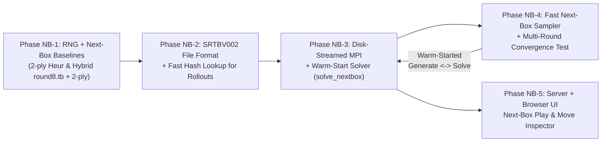

# Plan: 1-Piece Next-Box Tablebase (`V(b, c)`) for Very Low Lineout

Goal: Upgrade the isolated `experimental/tablebase/` testbed from No-Next-Box (`V(b)`) to **exact 1-piece Next-Box play (`V(b, c)`)**, while testing the exact speed and low-RAM techniques we'll need for full-game Level 19 DAS stacking tablebases:
- **Disk-streamed policy cache** (keeping RAM flat at `~88 bytes/board` by streaming the big temporary winning-moves list through a temp SSD file),
- **Warm-starting** (reusing last round's solved values instead of starting over from `0.0`),
- **Hash-table rollouts** (building `FlatBoardIndex` in RAM for `~1` memory read per move instead of `~24` binary-search jumps), and
- **Free exact 7×7 NES RNG** (using the real NES piece transition table at zero extra state cost).

Companion doc: [tablebase_plan.md](file:///Users/gregcannon/Documents/StackRabbit/docs/tablebase_plan.md) (v0 No-Next-Box ruleset and completed Phases 1–6).

---

## 1. Four Questions This Experiment Answers

Before building a full Level 19 DAS tablebase, solving this toy problem with a Next Box directly answers:

1. **Do we actually need `V(b, c)` in the tablebase, or is `V(b)` + 2-ply search good enough?**
   On the exact same seeds, how many extra lines does a dedicated Next-Box tablebase (`36 bytes/board`) beat our existing 15.95M-board No-Next-Box `round8.tb.bin` (`12 bytes/board`) when paired with a live 2-ply Next-Box search (placing `current` + `next` together and looking up `V_NNB` on the resulting board)?
2. **Does streaming the winning-moves list through SSD keep RAM low without hurting speed?**
   Can writing the `49` winning moves per board to a temporary SSD file and streaming them back during inner sweeps keep RAM around **`~88 bytes/board`** while still converging quickly on much longer Next-Box games?
3. **How much time do warm-starting and hash-table rollouts save?**
   How much faster is each expansion round when the solver starts from last round's values (`--init`) and the game generator uses `FlatBoardIndex` instead of binary search?
4. **How much does true 7×7 NES RNG change the game (at zero extra memory cost)?**
   Because the current piece `c` *is* the previous piece for the Next Box spawn `n`, how do exact NES piece probabilities ([piece_rng.cpp](file:///Users/gregcannon/Documents/StackRabbit/src/backend/piece_rng.cpp)) compare against uniform `1/7`?

---

## 2. Rules, Math, and File Format (v1 — Next Box)

### Gameplay & Value Equation
All 4×10 pre-clear ceiling rules, 1-input NES tucks/spins (`L, R, A, B, E, I, F, G`), reward ($r = \text{linesCleared} \in \{0..4\}$), and undiscounted scoring ($\gamma = 1$) stay identical to [tablebase_plan.md](file:///Users/gregcannon/Documents/StackRabbit/docs/tablebase_plan.md).

- **What the player sees on each turn**: `(b, c, n)` — board `b`, current active piece `c ∈ {0..6}`, and visible Next Box piece `n ∈ {0..6}`.
- **What the tablebase stores for each board**: **`7` floats — `V(b, c)`**, the expected total lines starting from board `b` with active piece `c` *before* seeing what spawns in the Next Box.
- **Exact Value Equation**:
  $$V^*(b, c) = \sum_{n=0}^{6} P(n \mid c) \max_{b' \in \text{Moves}(b, c)} \Big[ r(b, b') + V^*(b', n) \Big]$$
  where:
  - If `c` has zero legal placements on `b` (Top-Out), $V^*(b, c) = 0.0$.
  - Inside the solver on a finite board set $\mathcal{S}$, any move landing outside $\mathcal{S}$ gets $V(b', n) = 0.0$ (guaranteed safe lower bound — never overestimates).
  - During live play, if *every* legal placement of `c` lands outside $\mathcal{S}$, fall back to the 2-ply Next-Box heuristic (placing `c` and `n` jointly).
- **Zero extra move generation or hash lookups per sweep**:
  For a fixed `(b, c)`, the list of legal moves `Moves(b, c)` is identical no matter which of the 7 pieces `n` is in the Next Box. Each outer sweep generates `Moves(b, c)` **once** and looks up each resulting board `id = find(b')` **once**, then reads all 7 values `vCur[id * 7 + 0..6]` (which sit back-to-back in 28 bytes — a single CPU memory fetch).
- **RNG modes (`--rng=uniform|nes`)**:
  - `uniform`: $P(n \mid c) = 1/7$ for all `c, n`; headline metric is the average of $V(0, c)$ over all 7 opening pieces.
  - `nes`: $P(n \mid c) = \text{transitionProbability}[c][n] / 64$ (exact NES ROM table remapped to `I, O, L, J, T, S, Z` order); headline metric is $\sum_c \pi_{\text{NES}}(c) V(0, c)$ (the average weighted by NES long-term piece frequencies), with all 7 individual opening values $V(0, c)$ also printed.

### Binary File Format (`SRTBV002` — 36 bytes/board)
Keeps the existing `SRTBV001` No-Next-Box format untouched and adds a new versioned format for Next-Box tablebases:

- **Header (`NextBoxTablebaseHeader`, 40 bytes, no padding)**:
  ```cpp
  struct NextBoxTablebaseHeader {
    char magic[8];          // "SRTBV002"
    uint64_t numBoards;
    uint32_t rngMode;       // 0 = Uniform 1/7, 1 = Exact 7x7 NES
    uint32_t flags;         // Reserved (must be 0)
    double emptyBoardValue; // Expected V(0, c_0) under rngMode (-1.0 if empty board 0ULL is absent)
    double bellmanResidual; // Largest remaining update error across all N * 7 (b, c) entries
  };
  ```
- **Per-board record (`PackedNextBoxRecord`, exact 36 bytes on disk)**:
  - `uint8_t boardBytes[8]` (`uint64_t` 40-bit board, strictly sorted ascending)
  - `uint8_t valueBytes[28]` (`float values[7]` in `I, O, L, J, T, S, Z` order)
  - File sizes: `5M` boards = `172 MB`, `10M` = `343 MB`, `16M` = `549 MB`.

### Low-RAM MPI Design (`~88 bytes/board` in RAM)
- **Pack each winning move into 1 `uint32_t` (4 bytes instead of 5)**:
  - Bits `0..28`: `childId` (supports up to `536,870,910` boards; `0x1FFFFFFF` means "outside set").
  - Bits `29..31`: `linesCleared` (`0..4`).
  - Total size of the winning-moves list: `49 × 4 B = 196 bytes/board` (`3.1 GB` for `16M` boards).
- **Where the winning-moves list lives (`--policy-cache=auto|ram|disk`)**:
  - `ram`: stored in a normal `std::vector<uint32_t>` (great for smaller sets, e.g. `<= 6M` boards = `<= 1.18 GB`).
  - `disk` (default in `auto` above the RAM threshold): written sequentially to a temporary SSD file (`ScopedTempFile`, automatically deleted on exit or error) in `<= 32 MB` chunks, then streamed back sequentially during the inner sweeps — **`0 bytes` of RAM** for the policy cache at any board count.
- **Value arrays in RAM**:
  - Two `float` buffers (`vCur[N * 7]` + `vNext[N * 7]` = `56 bytes/board`) so worker threads read old values while writing new values cleanly with zero race conditions and identical results across thread counts.
  - All sums inside backups and inner sweeps accumulate in `double` precision so values never drift on long Next-Box games.
  - **Total solver RAM**: `boards (8 B)` + `FlatBoardIndex (~24 B)` + `vCur/vNext (56 B)` = **`~88 bytes/board`** (`16M` boards ≈ **`1.4 GB` RAM**; even `100M` boards ≈ **`8.8 GB` RAM**).



---

## 3. Phased Implementation Plan

### Phase NB-1: RNG Modes & Next-Box Baselines (`core.hpp`, `heuristic.hpp`, `benchmark_cli.cpp`)
Measure the exact scores to beat *before* training any `V(b, c)` tablebase.

- [x] Add `RngMode` (`Uniform`, `Nes`), exact `NES_TRANSITION_NUM[7][7]` (in `I, O, L, J, T, S, Z` order, cross-checked against [piece_rng.cpp](file:///Users/gregcannon/Documents/StackRabbit/src/backend/piece_rng.cpp)), `NES_STATIONARY_NUM/PROB[7]`, and `Rng::nextOpeningPiece` / `Rng::nextPiece(RngMode, int prevPiece)` to `core.hpp`.
- [x] Add Next-Box 2-ply heuristic `pickBestNextBoxHeuristic(board, curPiece, nextPiece, w)` and `scoreNextBoxHeuristicTransition` to `heuristic.hpp`.
- [x] Add **Hybrid No-Next-Box TB + 2-ply Next-Box** selector `chooseNextBoxHybridMove(board, curPiece, nextPiece, nnbTb, w)` to `vi_solver.hpp`.
- [x] Extend `benchmark_cli.cpp` with `--mode=nextbox-heur`, `--mode=nextbox-hybrid --tb=PATH`, and `--rng=uniform|nes`.
- [x] **Verification & 10,000-Game Baselines (`seed=700000`, using `round8.tb.bin`)**:
  - Next-Box 2-ply Heuristic (`uniform`): **`23.34 ± 0.22`** lines (`med=17.0, p90=52, max=173`)
  - Next-Box 2-ply Heuristic (`nes`): **`30.05 ± 0.28`** lines (`med=22.0, p90=67, max=237`)
  - Next-Box Hybrid `round8.tb` + 2-ply (`uniform`): **`51.42 ± 0.49`** lines (`med=36.0, p90=116, max=454`, `98.98%` in-TB leaves)
  - Next-Box Hybrid `round8.tb` + 2-ply (`nes`): **`76.68 ± 0.73`** lines (`med=54.0, p90=174, max=651`, `99.31%` in-TB leaves)

---

### Phase NB-2: `SRTBV002` File Format & Fast Hash-Table Rollout Lookups (`tablebase_io.hpp`, `vi_solver.hpp`)
Build the 36-byte Next-Box file format and fix the binary-search bottleneck in game generation.

- [x] Implement `writeNextBoxTablebaseFile`, memory-mapped reader `MappedNextBoxTablebase` (sharing `detail::MappedRecordFile` with `MappedTablebase`), and `detectTablebaseFormat(path)` (`SRTBV001` vs `SRTBV002`).
- [x] Add `IndexedTablebase` (No-Next-Box) and `IndexedNextBoxTablebase` (`V(b, c)`) backed by `FlatBoardIndex` + flat `std::vector<float>` (`O(1)` lookups).
- [x] Upgrade `state_generator.hpp` to use `IndexedTablebase` during rollouts and coverage evaluation, lifting 15.95M-board `round8.tb.bin` rollout speed from **`404.7k` → `573.3k mv/s` (+42% including index build)**.
- [x] **Verification**:
  - Round-trip save/load (including 0-board, move semantics, exact mod-2^64 overflow wrap-around, and negative/NaN/unsorted corruption rejection), `Mapped` vs `Indexed` lookup & policy parity tests in `tablebase_test.cpp`.

---

### Phase NB-3: Disk-Streamed & Warm-Started Next-Box MPI Solver (`nextbox_solver.hpp`, `solve_nextbox.cpp`)
Build the `V(b, c)` solver with low RAM (`~88 bytes/board`) and full Monte Carlo verification.

- [ ] Implement `packPolicyAction(childId, reward)` / unpack helpers (`29-bit id + 3-bit reward`) and `PolicyActionStore` supporting both `Ram` and chunked sequential `Disk` storage (`ScopedTempFile` that always cleans up its temp file on exit or error).
- [ ] Implement parallel two-buffer `solveNextBoxMPI(sortedBoards, index, cfg, initTbPtr)`:
  - Generates moves and hashes children once per `(b, c)`, shared across all `7` next pieces `n = 0..6`.
  - Accumulates sums in `double` into `float vCur`/`vNext` (`56 B/board`), 100% deterministic across thread counts.
  - Configurable `--inner-sweeps` (default `50` since NES Next-Box games run 5–7× longer than No-Next-Box) and `--init=prev.tb.bin` warm-starting (safe because adding boards can only raise values, so starting from last round's values climbs straight to the same exact answer in fewer sweeps).
  - Verifies exact largest update error across all `N × 7` entries after freeing the temp policy file/buffers.
- [ ] Implement `chooseNextBoxTablebaseMove(b, c, n, tb, closedWorld, w)` and multi-threaded `evaluateNextBoxPolicy` (closed-world Monte Carlo check against expected `V(0, c_0)` + live TB + 2-ply Next-Box fallback stats with hole-stratified coverage).
- [ ] Build `experimental/tablebase/solve_nextbox.cpp` (`./build/tablebase_solve_nb <in.states.bin> <out.tb.bin> [options]`) with strict flag validation (`--rng=uniform|nes`, `--policy-cache=auto|ram|disk`, `--init=PATH`, `--tol`, `--inner-sweeps`, `--mc-games`, `--eval-games`, `--seed`, `--threads`).
- [ ] **Verification**:
  - Unit tests in `tablebase_test.cpp`:
    - Exact 2-row brute-force check against an independent plain double-precision solver (both `Uniform` and `Nes`).
    - Bit-for-bit equality across thread counts (`1` vs `4`), across `Ram` vs `Disk` policy cache, and agreement between cold-start and warm-start.
    - Closed-world Monte Carlo agreement (`<= 3.5σ`) for both `Uniform` and `Nes` RNG.

---

### Phase NB-4: Fast Next-Box State Generator & Multi-Round Expansion (`nextbox_gen.hpp`, `generate_nextbox.cpp`)
Sample Next-Box-specific board shapes and run the head-to-head comparison.

- [x] Build `nextbox_gen.hpp` + `experimental/tablebase/generate_nextbox.cpp` (`./build/tablebase_gen_nb <out.states.bin> [options]`) and `--mode=nextbox-tb` in `benchmark_cli.cpp`:
  - Plays Next-Box self-play games `(b, c, n)` using `IndexedNextBoxTablebase` (`~1.8M–2.4M mv/s` on 10 threads).
  - Splits exploration (`ε`) 50/50 between tablebase runner-up moves and 2-ply Next-Box heuristic probes (sharing `detail::selectExploreTransition`, `detail::collectRolloutVisits`, `detail::collectCoreSiblings`, `detail::mergeFilterAndCapBoards`, and `detail::runCoverageEval` with `state_generator.hpp`).
  - Expands 1-ply heuristic + all-7-next-piece TB sibling replies on frequently visited core boards with per-worker deduplication to bound peak RAM.
  - Supports `--rng=uniform|nes`, `--tb=PATH`, `--merge=PATH`, `--min-visits`, `--max-boards`.
- [x] **Experiments & Head-to-Head Comparison (`seed=700000`, `10,000` identical games per eval, `--policy-cache=disk`, peak solver RAM `2.59 GB` on 15.95M boards)**:
  1. **NES Iterative Expansion Progression (`round8.states.bin` → `nb_final.states.bin`)**:
     - **Round 0** (`round8` reuse, `15,946,868` boards, cold start, `62` outer / `3,027` inner, `2,140s`, `tol=1e-7`, `2.59 GB` peak RSS): `E[V(0)] = 79.36` (MC `78.65 ± 0.54`, `1.32σ`) | Live = **`81.08 ± 0.78`** (`99.68%` in-TB, `59.65%` full games).
     - **Round 1** (`16,009,298` boards, `ε=0.04`, warm-start, `10` outer / `1,350` inner, `711s`): `E[V(0)] = 79.89` (MC `79.71 ± 0.54`, `0.33σ`) | Live = **`82.08 ± 0.79`** (`99.69%` in-TB, `61.45%` full games).
     - **Round 2** (`16,777,847` boards, `ε=0.02`, warm-start, `12` outer / `1,650` inner, `1,192s`): `E[V(0)] = 82.30` (MC `82.60 ± 0.57`, `0.52σ`) | Live = **`84.39 ± 0.82`** (`99.73%` in-TB, `66.66%` full games).
     - **Round 3** (`18,394,346` boards, `ε=0.008`, warm-start, `13` outer / `1,800` inner, `1,564s`): `E[V(0)] = 85.21` (MC `85.43 ± 0.59`, `0.37σ`) | Live = **`87.90 ± 0.85`** (`99.76%` in-TB, `70.07%` full games).
     - **Round 4 (`nb_final`)** (`19,540,639` boards, `ε=0.002`, warm-start, `12` outer / `1,650` inner, `1,684s`, `670.9 MB` `.tb.bin`): `E[V(0)] = 86.85` (`I=87.77, O=86.87, L=87.79, J=87.80, T=87.43, S=85.30, Z=85.10`; MC `87.01 ± 0.60`, `0.27σ`) | Live = **`89.90 ± 0.88`** (`med=63.0, p90=203, max=921`, `99.79%` in-TB, `0h=100.00%, 1h=99.83%, 2h=97.97%, 3+h=87.67%`, `72.86%` full games).
  2. **Uniform Comparison Solve (`nb_final.states.bin`, `19,540,639` boards, cold start, `14` outer / `1,793` inner, `1,743s`)**:
     - `E[V(0)] = 57.34` (`I=58.19, O=57.39, L=58.26, J=58.26, T=57.78, S=55.85, Z=55.63`; MC `56.74 ± 0.39`, `1.52σ`) | Live = **`58.32 ± 0.57`** (`med=41.0, p90=131, max=508`, `99.69%` in-TB, `73.15%` full games).
  3. **Final Side-by-Side Comparison (`10,000` identical games, `seed=700000`)**:
     - **Evaluated on NES RNG**:
       - 2-ply Next-Box Heuristic: **`30.05 ± 0.28`** (`med=22, p90=67, max=237`)
       - Hybrid `round8.tb` + 2-ply: **`76.68 ± 0.73`** (`med=54, p90=174, max=651`)
       - Next-Box `nb_round0_nes` (`round8` reuse): **`81.08 ± 0.78`** (`med=57, p90=184, max=892`)
       - Next-Box `nb_final_uniform` (Uniform-trained): **`86.49 ± 0.85`** (`med=60, p90=196, max=982`)
       - Next-Box `nb_final_nes` (NES-trained): **`89.90 ± 0.88`** (`med=63, p90=203, max=921`) — **`+3.41` lines** purely from conditioning on true NES RNG, **`+13.22` lines (+17.2%)** over Hybrid `round8.tb + 2-ply`!
     - **Evaluated on Uniform `1/7` RNG**:
       - 2-ply Next-Box Heuristic: **`23.34 ± 0.22`** (`med=17, p90=52, max=173`)
       - Hybrid `round8.tb` + 2-ply: **`51.42 ± 0.49`** (`med=36, p90=116, max=454`)
       - Next-Box `nb_final_nes` (NES-trained): **`56.67 ± 0.54`** (`med=40, p90=128, max=451`)
       - Next-Box `nb_final_uniform` (Uniform-trained): **`58.32 ± 0.57`** (`med=41, p90=131, max=508`) — **`+6.90` lines (+13.4%)** over Hybrid, **`+1.65` lines** over NES-trained on Uniform!
- [x] **Verification**:
  - Unit tests in `tablebase_test.cpp`: `1T` vs `4T` determinism (Uniform & NES, with/without TB & merge), frontier probing & exact `tbQ` tie-breaking parity, boundary cases, multi-`next` sibling expansion & dedup, tight `maxBoards` cap with `priorBoards` + `0ULL` preservation, coverage determinism, and round-over-round monotonicity (`V_1(0, c) >= V_0(0, c)` for all `c = 0..6`).

---

### Phase NB-5: Browser UI & Server Next-Box Support (`server_routes.hpp`, `server.cpp`, `index.html`)
Make the Next-Box tablebase playable and inspectable interactively in the browser.

- [x] Auto-detect `SRTBV001` (No-Next-Box) vs `SRTBV002` (Next-Box) in `server.cpp` and `ServerContext::openTablebase` (on startup and `/reload`, atomically preserving the prior mmap on error) and report `tablebaseFormat` (`"nnb"` / `"nextbox"` / `"none"`) and `rngMode` (`"uniform"` / `"nes"` / `null`) in `/ping`.
- [x] Extend `/moves?board=...&piece=c&next=n` and `/state-info?board=...&next=n` to score `r + V(b', n)`, report piece-specific `V(b, c)`, return all 7 `boardValues` and exact per-piece/expected Bellman backups, and strictly reject missing/invalid `next` when an `SRTBV002` tablebase is loaded (keeping 100% backwards compatibility for `SRTBV001`).
- [x] Update `index.html`:
  - Add a visual 4×2 **Next Piece** preview grid + **Next Piece** selector pills (matching the C++ piece RNG stream bit-for-bit in JS for both Uniform and NES modes, auto-syncing `nbTb` policy and `NES RNG` checkbox on connect/reload).
  - Compare `r + V(b', next)` against the 2-ply Next-Box heuristic in the Move Inspector and per-piece `V(b, c)`/`Q` strip, with working Autoplay, Undo, Edit Mode (choose both current and next piece), and **Step to Disagreement**.
- [x] **Verification**:
  - Unit tests in `tablebase_test.cpp` numerically verifying `/ping`, `/reload` (including format switching and corrupt-file rollback), `/moves` (piece-specific `V(b, c)` and `400` rejections), `/state-info` (`boardValues`, exact Bellman backup agreement, top-out, and disagreement/all-OUT fallback), plus a live HTTP smoke check against `build/tablebase_server` serving the 19.54M-board `nb_final_nes.tb.bin`.

---

## 4. Quality Gates & Review Protocol

Every phase follows the same checklist as v0:
- Keep all experimental code isolated under `experimental/tablebase/` (`src/backend/` stays untouched).
- Validate inputs strictly at every boundary (CLI flags, binary readers, HTTP query params).
- After each phase:
  1. `npm run format_cpp`
  2. Compile all `experimental/tablebase/` binaries with `-Wall -Wextra -Werror`
  3. Run `./build/tablebase_test`, `npm run cpp_test_unit`, and `npm run precompute_static_lint`
  4. Run both **`logic_reviewer`** and **`readability_reviewer`** subagents and fix any issues before moving on.
