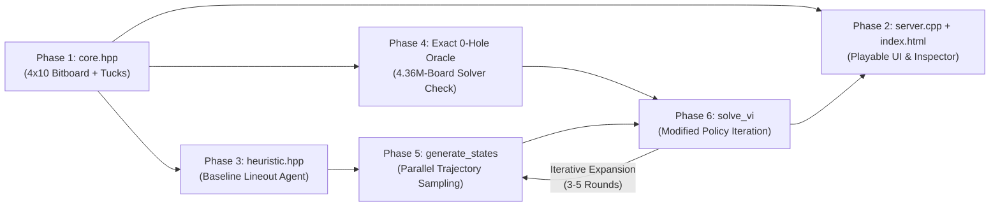

# Plan: "Very Low Lineout" Tablebase Experiment

Goal: Build an isolated, end-to-end experimental testbed (`experimental/tablebase/`) for solving a constrained NES Tetris subgame (**Very Low Lineout**) via sampled state-space generation and Value Iteration, validating the infrastructure and algorithms needed before tackling real Level 19 DAS stacking tablebases.

---

## 1. Ruleset & Mathematical Specification (v0)

### Gameplay Rules
- **Playfield & Pre-Clear 4-Row Ceiling**:
  - Width: 10 columns (`col = 0..9`).
  - Height cap: Only the bottom 4 rows may ever contain locked minos (the top 16 rows must remain empty).
  - **Pre-clear enforcement**: A placement is legal **iff all 4 minos of the piece at lock time lie within the bottom 4 rows** *before* line clears are resolved.
  - **Top-Out**: If the current piece has zero legal placements within the bottom 4 rows, the game ends immediately with `0` additional reward.
- **Objective & Reward**:
  - Maximize total expected lines cleared prior to Top-Out.
  - Immediate reward $r(b, b') = \text{linesCleared} \in \{0, 1, 2, 3, 4\}$ (1 point per line; no 4-line Tetris bonus).
  - Stationary, undiscounted ($\gamma = 1$), absorbing infinite-horizon MDP (`lines` and `level` are excluded from the state).
- **Piece RNG & Information Model (v0)**:
  - Pieces: `I, O, L, J, T, S, Z` (`0..6`, matching [tetrominoes.hpp](file:///Users/gregcannon/Documents/StackRabbit/src/data/tetrominoes.hpp)).
  - **No Next Box (NNB)** + **Uniform `1/7` i.i.d. RNG**.
  - **No horizontal mirror canonicalization** (preserving direct compatibility with asymmetric NES RNG and asymmetric reachability in later versions).

### Move Physics (Unconstrained Entry + 1-Input Tuck/Spin)
To eliminate tap/DAS timeline complexity while retaining overhang play:
- **Coordinate frame**: Move search runs in an 8-row local grid `y = 0..7` (`y = 0..3` are empty entry rows above the ceiling; `y = 4..7` are the 4 playable bottom rows). Because every piece fits in a `4×4` bounding box, `y = 0` is guaranteed collision-free above the stack for every valid `(rot, x)`.
- **Direct drops**: Every valid `(rot, x)` within wall bounds drops straight from `y = 0` down to `maxDropY[rot][x]` (the lowest `y` before `y + 1` collides with the stack or floor). If all 4 minos at `maxDropY[rot][x]` lie in `y = 4..7`, the placement is legal.
- **1-input tucks & spins**: Matching StackRabbit's single-frame tuck model ([move_search.cpp](file:///Users/gregcannon/Documents/StackRabbit/src/backend/move_search.cpp#L253-L299) and `TUCK_INPUTS[8]` in [tetrominoes.hpp](file:///Users/gregcannon/Documents/StackRabbit/src/data/tetrominoes.hpp#L171-L180)), from any straight-droppable mid-air state `(preRot, preX, y)` with `y <= maxDropY[preRot][preX]`, try each of `L, R, A, B, E(L+A), I(R+A), F(L+B), G(R+B)` in NES `Shift → Rotate` order:
  1. Only test `y` in the overhang window `maxDropY[postRot][postX] < y <= maxDropY[preRot][preX]` (if `y <= maxDropY[postRot][postX]`, `(postRot, postX, y)` is already reachable by a straight drop).
  2. Verify no collision after shift `(postX, y, preRot)` and no collision after rotation `(postX, y, postRot)`.
  3. Drop straight down from `(postX, y, postRot)` to `lockY` and accept if all 4 minos lie in `y = 4..7`.
- **Transition deduplication**: Multiple `(rot, x, tuck)` placements that produce the exact same post-clear `uint64_t` board always clear the same number of lines ($\text{popcount}(b') = \text{popcount}(b) + 4 - 10r$) and are deduplicated to unique `b'` transitions for search and Value Iteration (preferring non-tuck `'.'` metadata for UI display).

### Board Bit-Packing & Bellman Equation
- **`uint64_t` 40-bit board**:
  - Bits `0..9` = row 0 (bottom floor), bits `10..19` = row 1, bits `20..29` = row 2, bits `30..39` = row 3 (4th row from bottom). Within each 10-bit row, `col 0..9` maps to `1 << (9 - col)` (matching `CELL_BIT(col)` in [utils.hpp](file:///Users/gregcannon/Documents/StackRabbit/src/backend/utils.hpp#L24)).
  - Empty board = `0ULL`. Sorting `uint64_t` keys naturally orders boards from low height to high height, and clearing row `r` shifts higher 10-bit lanes right (`>> 10`) with zero top-masking.
- **Afterstate Bellman Optimality (`V(b)`, 1 value per board)**:
  $$V^*(b) = \frac{1}{7} \sum_{c=0}^{6} \max_{b' \in \text{Moves}(b, c)} \big( r(b, b') + V^*(b') \big)$$
  where piece terms with $\text{Moves}(b, c) = \emptyset$ contribute `0.0`.
- **Sampled-Subset Boundary Rule ($b' \notin \mathcal{S}$)**:
  - Inside Value Iteration on a finite state set $\mathcal{S}$, transitions to $b' \notin \mathcal{S}$ evaluate $V(b') = 0.0$. Because $r \ge 0$, the converged solution $V_{\mathcal{S}}^*(b) \le V^*(b)$ is a **provable, non-hallucinating lower bound** with zero out-of-distribution overestimation.
  - At *live play / rollout time*, if every legal move for `(b, c)` exits $\mathcal{S}$ (or when $b \notin \mathcal{S}$), the agent falls back to the heuristic evaluator.

---

## 2. Directory Layout & Isolation

All code lives under `experimental/tablebase/` so production StackRabbit code (`src/backend/`) stays completely untouched:

```text
experimental/tablebase/
├── core.hpp              # 40-bit board ops, tetromino masks, drop + 1-tuck move gen, PRNG
├── heuristic.hpp         # Fast 4-row lineout eval + 1-ply / 2-ply expectimax baseline agent
├── tablebase_io.hpp      # Compact binary state-set & mmap-ready tablebase file format + flat hash index
├── tablebase_test.cpp    # Unit tests (board ops, ceiling, tucks/spins, Bellman sanity checks)
├── server.cpp            # Standalone HTTP server (default port 3030) for the HTML harness
├── index.html            # Playable game + board editor + Tablebase vs. Heuristic move inspector
├── generate_states.cpp   # Multi-threaded self-play trajectory sampler & coverage reporter
├── solve_vi.cpp          # Multi-threaded Gauss-Seidel / Modified Policy Iteration solver
└── data/                 # Gitignored binary outputs (*.states.bin, *.tb.bin)
```



---

## 3. Phased Execution Roadmap

### Phase 1: Core 4×10 Engine & Unit Tests (`core.hpp`, `tablebase_test.cpp`)
Build the single source of truth for board representation and move generation, shared by the server, generator, and solver.

- [x] Implement `Board4x10` (`uint64_t`) helpers: ASCII/grid conversion, row extraction, branch-minimal 4-row line clear + `linesCleared` count, column heights `h[10]`, hole/overhang bitmasks, and even-popcount invariant check.
- [x] Port `I, O, L, J, T, S, Z` `4×4` rotation masks and `TUCK_INPUTS[8]` into self-contained `constexpr` tables in `core.hpp` (no header dependency on `src/backend/types.hpp`).
- [x] Implement `generatePlacements` / `generateTransitions`:
  - Straight drops across all valid `(rot, x)` recording `maxDropY[rot][x]`.
  - Forward 1-input tuck/spin enumeration in the overhang window `maxDropY[postRot][postX] < y <= maxDropY[preRot][preX]` with `Shift → Rotate` collision checks and post-tuck gravity.
  - Pre-clear 4-row ceiling filter (`y = 4..7` only) and `afterBoard` deduplication.
- [x] Add deterministic seedable `SplitMix64` / `Xoshiro256**` PRNG for reproducible uniform `1/7` piece streams across threads.
- [x] **Verification (`tablebase_test.cpp`)**:
  - Empty-board placement counts per piece (`I: 17`, `O: 9`, `T/L/J: 34`, `S/Z: 17` — matching pre-clear 4-row geometry).
  - Pre-clear ceiling rejection tests (e.g., vertical `I` rejected on `h >= 1`; `O` rejected on `h >= 3`; 4-line clear from row 0 accepted).
  - Explicit 1-input tuck (`L`/`R`), spin (`A`/`B`), and shift+spin (`E`/`I`/`F`/`G`) overhang fixtures, verifying Shift-before-Rotate blocking matches StackRabbit.
  - Fuzz 100k random game steps asserting `popcount(board) % 2 == 0`, no full rows `0x3FF`, and zero empty rows below non-empty rows, plus 3,500 random `(board, piece)` cross-checks against an independent raw-bit brute-force oracle.

---

### Phase 2: Local HTTP Server & Interactive HTML Harness (`server.cpp`, `index.html`)
Deliver a clean browser UI for human play, board editing, and side-by-side Tablebase vs. Heuristic inspection.

- [x] Build `server.cpp` + `server_routes.hpp` + `tablebase_io.hpp` (zero-dependency POSIX socket HTTP server, default port `3030`, `mmap` support for optional `*.tb.bin` tablebase passed on CLI):
  - `GET /ping` → health + loaded tablebase metadata (`boardCount`, `emptyBoardValue`, `bellmanResidual`).
  - `GET /reload` → re-`mmap`s the CLI-configured `*.tb.bin` file without restarting.
  - `GET /moves?board=<hex_or_40chars>&piece=<0..6_or_I..Z>` → JSON list of legal moves with `afterBoard`, `linesCleared`, `rot`, `x`, `lockY`, `tuckInput`, `heuristicScore`, `afterInTablebase`, and `tablebaseQ` (`r + V(b')`).
  - `GET /state-info?board=<...>` → `V(b)` if in tablebase, per-piece best `Q` and policy disagreement flags, and heuristic breakdown.
- [x] Build `index.html`:
  - **Play mode**: Visual 20-row board with top 16 rows shaded/locked out and bottom 4 rows active; click a ghost placement from the move list or use keyboard controls (`Left/Right`, `Z/X` rotate, `Down` step-down for 1-input tuck/spin + combo `E/I/F/G`, `Space` drop) to play.
  - **Edit mode**: Paint/erase cells in the 4×10 grid (with non-canonical / odd-popcount warning) and pick current piece `I..Z` to test specific overhangs/tucks interactively.
  - **Inspector & Replay**: Ranked move table comparing Tablebase `r + V(b')` vs. Heuristic score with `IN` / `OUT` and `TB` / `HEUR` badges; AI autoplay controls with speed slider, `Undo`, and **"Step to Disagreement"** button.
- [x] **Verification**:
  - Unit-tested binary I/O (`tablebase_io.hpp`), overflow/corruption guards, and strict HTTP route validation (`server_routes.hpp`), plus live TCP socket smoke check against `build/tablebase_server`.

---

### Phase 3: Baseline Heuristic Agent (`heuristic.hpp`, `benchmark_cli.cpp`)
Create a fast, clean 4-row lineout agent to seed Round 0 state generation and serve as the out-of-tablebase fallback.

- [x] Implement `evalLineoutBoard(uint64_t board, const EvalWeights &w)`:
  - Immediate line clear reward.
  - Sealed holes penalty and side-accessible overhang (tuck-setup) penalty.
  - Column height penalties (`sumHeightSq`, `height3Cols`, and `ceilingCols` at `h = 4`).
  - Surface bumpiness $\sum |h_i - h_{i+1}|$, `O`-safe flat-spot bonus (`h_i == h_{i+1} <= 2`), row-fill concentration $\sum c_r^2$, parity imbalance, and narrow-well (`depth >= 2`) penalties.
- [x] Implement 1-ply NNB (`pickBestTransition1Ply`) and lossless branch-and-bound 2-ply NNB expectimax (`pickBestTransition2Ply` / `scoreTransition2Ply`, plus `ply=1|2` integration in `server_routes.hpp` and `index.html`).
- [x] Add `benchmark_cli.cpp` to measure throughput (`moves/sec`) and average/median/p90 lines cleared over `N` fixed-seed games, plus a staged 1-ply + 2-ply weight tuner.
- [x] **Verification**:
  - Confirmed deterministic fixed-seed game scores, verified bit-exact pruning equivalence across 3,500+ random/adversarial cases, verified 2-ply beats 1-ply (`~11.0` vs `~7.8` mean lines on NNB pre-clear 4-row cap), and verified single-core throughput (`> 500k moves/sec` for 1-ply, `> 20k moves/sec` for 2-ply).

---

### Phase 4: Exact Bounded-Overhang Oracle Solver (`vi_solver.hpp`, `solve_oracle.cpp`)
Before mixing sampling errors with solver debugging, validate the Value Iteration / Modified Policy Iteration engine on an exact, closed-world bounded-overhang state space (`sealedHoles == 0 && overhangs <= 1`, so `S`/`Z` openings on the empty board and 1-input overhang tuck setups are legal in-set).

- [x] Enumerate all **31,197,715** canonical 4×10 boards with `sealedHoles == 0 && overhangs <= 1` (`0.70s`, `357.0 MB` on disk), plus `--pure-surface` mode (**4,358,525** pure-surface boards, `0.16s`, `49.9 MB`).
- [x] Implement `FlatBoardIndex` (`uint64_t -> uint32_t` power-of-two open-addressing hash map) and parallel double-buffered Modified Policy Iteration (`solveValueIterationMPI` in `vi_solver.hpp`).
- [x] **Verification**:
  - Verified Bellman residual drops monotonically to `< 1e-6` in `double` precision (`0.17σ` agreement between `V(empty)` and 50,000-game closed-world Monte Carlo rollouts).
  - Verified bit-for-bit determinism of `solveValueIterationMPI` across thread counts (`1` vs `4` threads) and exhaustive `2^20` brute-force parity on 2-row boards in `tablebase_test.cpp`.
  - Saved `mmap`-ready `.tb.bin` tablebases (`oracle_0hole.tb.bin` and `oracle_1overhang.tb.bin`) loadable directly by `build/tablebase_server`.

---

### Phase 5: Parallel Trajectory State-Space Generator (`state_generator.hpp`, `generate_states.cpp`)
Generate plausible state spaces (including holes, overhangs, and tuck setups) via self-play rollouts.

- [x] Implement multi-threaded self-play worker pool accumulating `(uint64_t board -> uint32_t visitCount)` via thread-local `FlatVisitMap` + decorrelated 64-shard `ShardedVisitCounter` (zero hot-loop contention, bit-for-bit thread-count deterministic).
- [x] Support **exploration policy** (`selectRolloutTransition`):
  - With probability `1 - ε`: play greedy move (using loaded `*.tb.bin` when available, falling back to Phase 3 1-ply/2-ply heuristic if all moves exit the tablebase).
  - With probability `ε` (e.g. `ε = 0.08`): sample uniformly among runner-up top-`K` moves (`ranks 2..K`) so off-policy sibling states and recovery scrambles get populated.
  - Optional **1-ply sibling expansion** (`--sibling-min=M`) for frequently visited boards (`visits >= M`): inserts greedy responses across all 7 pieces to plug interior `0.0` frontier holes.
- [x] Support merging into an existing `*.states.bin` file (`--merge=PATH`) and filtering by `minVisits` up to a deterministic `maxBoards` cap (preserving `0ULL` and protected prior boards).
- [x] Log held-out greedy coverage metrics (overall move hit-rate, 100%-covered game %, and stratified by hole count `0, 1, 2, 3+`).
- [x] Write sorted `uint64_t` array to `*.states.bin` (tested on 250k pure 2-ply games: `673,453` boards / `5.1 MB` achieving `82.60%` overall and `93.44%` 0-hole held-out hit rate in `47s`).

---

### Phase 6: Value Iteration / Modified Policy Iteration Solver & Iterative Loop (`solve_vi.cpp`)
Solve `V(b)` over arbitrary sampled state sets $\mathcal{S}$ and run iterative state-space expansion.

- [x] **Indexing & Memory Layout**:
  - Load sorted `uint64_t boards[N]` from `*.states.bin` via `tb::readStatesFile`.
  - Build read-only `tb::FlatBoardIndex` (`uint64_t key -> uint32_t id`, `<= 50%` load factor) for `O(1)` child lookups without storing the edge graph in RAM.
  - Maintain working values in `double V[N]` to prevent `float32` precision drift.
- [x] **Modified Policy Iteration (MPI) Engine (`solve_vi.cpp`, `vi_solver.hpp`)**:
  - Parallel double-buffered Policy Improvement + 25 fixed-policy inner evaluation sweeps until exact Bellman residual `< 1e-7` (100% deterministic across thread counts).
  - Shared multi-threaded `evaluateTablebasePolicy` verifying closed-world MC mean against `V(0ULL)` (`<= 3.5σ`, zero step-cap hits) and reporting live TB + heuristic fallback metrics (mean/SE/median/p90/max, `% in-TB`, `% all-OUT fallback`, `100%`-covered games, and hole-stratified coverage).
- [x] **Binary Tablebase Output (`*.tb.bin`)**:
  - Header (`magic`, `numBoards`, `emptyBoardValue`, `bellmanResidual`) + `N` sorted 12-byte records (`uint64_t board` + `float value`), directly `mmap`-able by `build/tablebase_server`.
- [x] **Iterative Expansion Experiment (5 Rounds, Pure 2-Ply Seed — Zero Oracle Input)**:
  - Upgraded `selectRolloutTransition` (50/50 TB runner-up + heuristic frontier probe) and `expandCoreSiblings` (heuristic + TB replies) so iterative expansion actively discovers high-value states outside $S_k$.
  - Measured progression over 10,000 fixed-seed held-out games (`seed=700000`, vs. Phase 3 1-ply `8.08`, 2-ply `10.55`, and Phase 4 31.2M-board `oracle_1overhang` `V(empty)=8.385` / live `10.79`):
    - **Round 0**: `673,453` boards (`7.7 MB`, solve `6.0s`) — `V(empty)=6.687` | live `10.78 ± 0.10` | `87.01%` in-TB (`9.54%` full games)
    - **Round 1**: `1,960,573` boards (`22.4 MB`, solve `24.5s`) — `V(empty)=9.589` | live `11.84 ± 0.11` | `94.38%` in-TB (`33.59%` full games)
    - **Round 2**: `2,487,192` boards (`28.5 MB`, solve `32.0s`) — `V(empty)=10.369` | live `12.23 ± 0.11` | `95.72%` in-TB (`41.58%` full games)
    - **Round 3**: `5,065,535` boards (`58.0 MB`, solve `70.0s`) — `V(empty)=11.458` | live `12.69 ± 0.12` | `97.16%` in-TB (`53.55%` full games)
    - **Round 4**: `7,864,532` boards (`90.0 MB`, solve `110.7s`) — `V(empty)=12.295` | live `13.29 ± 0.12` | `98.05%` in-TB (`62.98%` full games; `0h: 99.89%`, `1h: 97.72%`, `2h: 87.80%`, `3+h: 57.17%`)
    - **Round 5** (`2.0M` games, `ε=0.02`): `10,365,511` boards (`118.6 MB`, gen `180.6s`, solve `116.8s`) — `V(empty)=12.835` | live `13.66 ± 0.13` | `98.53%` in-TB (`69.83%` full games)
    - **Round 6** (`2.5M` games, `ε=0.01`): `12,560,879` boards (`143.7 MB`, gen `235.5s`, solve `150.8s`) — `V(empty)=13.172` | live `14.09 ± 0.13` | `98.87%` in-TB (`75.11%` full games)
    - **Round 7** (`3.0M` games, `ε=0.005`): `14,526,005` boards (`166.2 MB`, gen `292.4s`, solve `192.9s`) — `V(empty)=13.395` | live `14.22 ± 0.13` | `99.08%` in-TB (`78.94%` full games)
    - **Round 8** (`3.0M` games, `ε=0.000`): `15,946,868` boards (`182.5 MB`, gen `310.2s`, solve `239.2s`) — `V(empty)=13.523` | live `14.34 ± 0.13` | `99.19%` in-TB (`81.27%` full games; `0h: 99.98%`, `1h: 99.45%`, `2h: 95.91%`, `3+h: 78.13%`)

---

## 4. Planned Follow-Ups (Post-v0)

Once the v0 `V(b)` pipeline is verified end-to-end:
1. **Dynamic NES RNG Ablation (`V(b)` vs. `V(b, prevPiece)` on NNB)**: Swap in `transitionProbability[7][7]` from [piece_rng.cpp](file:///Users/gregcannon/Documents/StackRabbit/src/backend/piece_rng.cpp) and empirically measure the exact line-clear delta of conditioning on `prevPiece`.
2. **1-Piece Next Box (`V(b, currentPiece)`, `float v[7]`)**: Widen table records from `12 B` to `36 B` (`uint64_t` + `float[7]`) to solve exact 1-piece Next Box play with zero extra move-generation cost per sweep.
3. **Level 19 Gravity + DAS Charge Buckets (`V[board][7][3]`)**: Replace unconstrained entry with simulated Level 19 frame physics and 3 `dasChargeAfter` buckets (`low / partial / full`) as a direct stepping stone toward full stacking tablebases.
